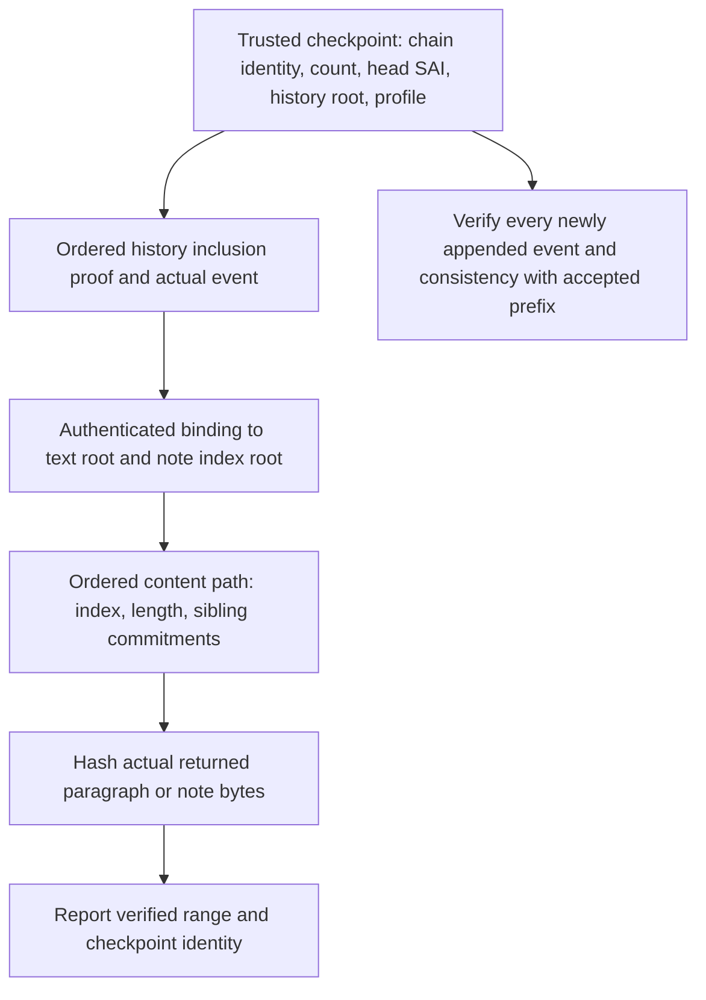

# Incremental and partial verification

Status: proposal, 2026-10-12. No partial-verification runtime API or new wire
format is introduced by this document. Existing Go/TS cryptographic primitives,
Pageforge events and storage/v0.1.0 retain their current verification behavior.

## Guarantees and limits

A verified subset can remain cryptographically bound to a complete committed
version. It cannot attest that unread physical files are currently present and
uncorrupted. These are distinct guarantees; a response must identify its scope.

| Operation | Evidence | Guarantee |
| --- | --- | --- |
| Append after a verified prefix | Trusted prefix state, every new event, resulting head | New suffix extends that verified prefix and obeys checked application rules |
| Read an event or range | Trusted root/count, inclusion paths, actual event bytes | Returned records occur at their claimed positions in the committed history |
| Read text/note subset | Trusted event-to-content-root binding, ordered path, actual bytes | Returned content belongs to the committed version at the claimed position |
| Full audit | All reachable actual files, event rules, chain/head anchor | All audited data passed at audit time; not a timeless filesystem snapshot |

Hashing a root supplied by the same untrusted manifest is not a trust anchor.
Hash chains without an independently trusted head also cannot prevent an attacker
from rewriting the whole chain and replacing the manifest. Even signatures do
not prevent replay of an older valid checkpoint unless the consumer retains an
accepted head/count or has another rollback-detection mechanism.

## Existing implementation

L0 computes SAI = SHA256("VAX-SAI" || prevSAI || SHA256(SAE)). Given a trusted
previous SAI, each new event can be checked incrementally. For a historical event,
checking its own SAI and supplied prevSAI only proves that local relation; it does
not prove ancestry to the accepted current head.

The storage companion already builds content-addressed ordered PFCO trees, but
Session.VerifyText recursively loads all children. It exposes no range proof API.
Its opaque note blob is indivisible. A tree root is not the SHA-256 digest of
concatenated leaf text; ordinary SHA-256 chunk digests cannot be combined to
recover the existing full-text SHA-256 commitment.

Pageforge events currently commit full-text and canonical whole-note hashes,
not textRoot/notesRoot. A proof for a catalog root alone therefore does not bind
that root to an existing SAI. Root-to-event binding is required before fast reads
can replace the current full-content validation path.

## Proposed proof path

The history index is an ordered append-only Merkle tree over explicitly encoded
records including chain identity, index, event ID, prevSAI, SAI and SAE digest.
Include any auxiliary root bindings in its authenticated representation. Use
domain separation, explicit lengths, an encoding/profile version, leaf count,
and position-aware proofs. Inclusion proves membership; consistency proves that
an accepted old prefix is unchanged in a larger tree. Neither proof alone proves
event semantics or VAX chain continuity across all leaves. Establish that state
by full baseline verification and checking every newly accepted suffix event.

Merkle inclusion and consistency proofs are described in
[RFC 9162 sections 2.1.3 and 2.1.4](https://www.rfc-editor.org/rfc/rfc9162.html#section-2.1.3).
This proposal adapts those proof concepts; it does not adopt the CT transport,
certificate schema, or declare the existing PFCO tree a CT-compatible log.

For a content proof, validate the root binding, branch encoding, ordered sibling
references, actual selected leaf bytes, byte lengths and requested range. Enforce
proof-size/depth/node bounds and reject omitted or surplus proof material.
Partial plaintext at a leaf boundary needs the complete leaf or a finer
authenticated subtree; a hash of the selected substring is insufficient.

## Legacy events and new events

For old histories, first perform existing full validation. A host-protected
checkpoint can then authenticate the correspondence between each event's original
full-content commitments and the actual storage roots verified in that audit.
Retain original SAE and SAI bytes. Without a trusted binding, fall back to full
verification; an unsigned sidecar copied from the same library is insufficient.

For new histories, version the application event schema to include content roots
as canonical SAE fields. Keeping both full-content hashes and roots still requires
full hashing when producing that event; the benefit is cheaper subsequent partial
reads. A later root-only event profile changes the application verification
contract and needs explicit migration. Existing VAX L0 hash formulas need not change.

Notes need immutable per-note objects and an authenticated ordered/indexed tree
before one note can be verified without reading the entire note-array blob.
This also addresses accumulating-note O(N²) storage, which proofs alone cannot fix.

## Host and SDK boundaries

The core SDK keeps L0 SAI and canonical encoding. Reusable bounded proof primitives
belong upstream as an optional companion. The storage SDK can supply selective
object-path reads and byte verification. Pageforge owns document identity, restore
references, allowed events, notes, checkpoints, protected keys and publication CAS.
Avoid embedding Pageforge models, OAuth or filesystem trust policy in VAX L0.

A checkpoint binds at least format/profile, application schema, chain/document
identity, genesis/original commitment, count, head SAI, history root, and verified
root bindings or their digest. The host chooses how that checkpoint is trusted.
In-memory receipts require a fresh baseline after restart. Persisted authenticated
receipts require protected trust material and rollback detection. Remote consumers
need a known verifier/owner key or independently accepted anchor; a signature only
authenticates its signer and is not evidence of a full audit by itself.

## Acceptance sequence

1. Preserve current full-audit mode and historical fixtures. Record explicit
   checkpoint, verified scope and last-audit information; do not return a generic
   all-files-verified flag for a partial read.
2. Add receipt-based suffix verification under the writer lock and head CAS,
   preserving application validation, limits and failure-before-publication.
3. Split note objects and build the ordered note index; measure accumulating notes.
4. Add ordered history proofs and selective PFCO paths with authenticated bindings.
5. Add bounded background audits and explicit audit export. Report unread data as
   unaudited since its last audit; failed proofs are integrity failures, not silent
   checkpoint replacements.

Tests must cover bit flips, wrong chain/profile/index/count, reordered leaves,
wrong root bindings, missing/extra proof nodes, truncated suffix, invalid restore
references, replayed old checkpoints and malformed bounds. A corrupted unread leaf
must leave a partial read scoped as partial and be detected when that leaf is read
or in a full audit. Compare proof acceptance against existing full verification.
